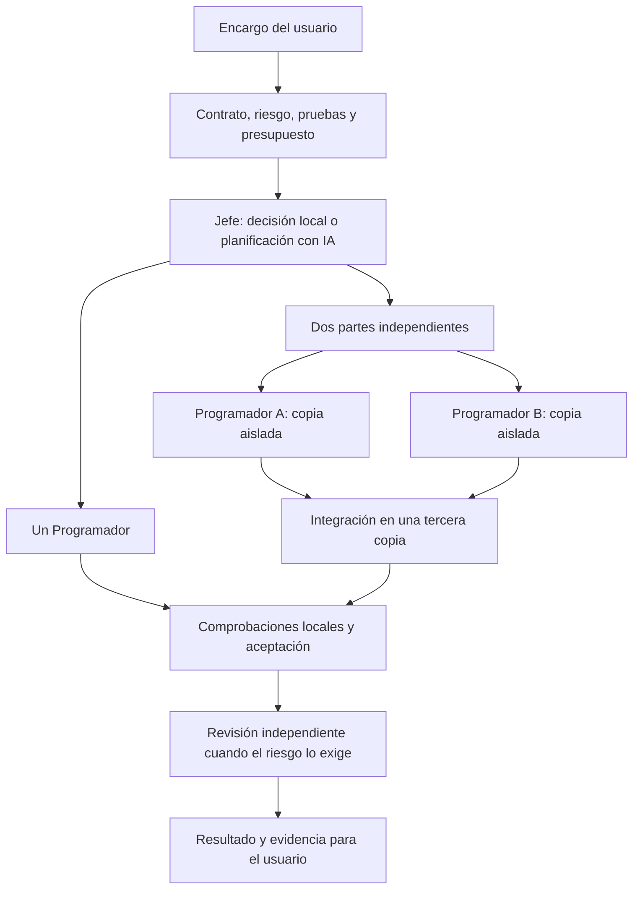

# Sistemas avanzados de programación con agentes y aplicación a Agents Sims

Consulta: 21 de octubre de 2026. Código local revisado: `f2f4559`.
Investigación y propuesta: sin cambios de ejecución, instalaciones, pilotos nuevos,
conexiones de proveedores ni modificaciones visuales. El inventario reproducible
de fuentes, repositorios y límites está en [FUENTES.json](FUENTES.json).

## Recomendación

Mantener Agents Sims como aplicación y capa de decisiones del usuario. Aprovechar
Codex CLI/App Server como ejecutor oficial y ampliar de forma selectiva la
integración existente con Agent Orchestrator para espacios de trabajo y sesiones.
No construir otro bucle de herramientas, gestor de credenciales o plataforma
multiagente general. Tampoco sustituir ahora la aplicación completa por otro producto.

El objetivo técnico propuesto es una oficina que elige entre un Programador,
ayudantes de lectura, revisión independiente y dos Programadores aislados. Elige
según la tarea y la evidencia, reservando presupuesto para terminar e integrar.
Dos trabajadores son una primera capacidad por validar, no una garantía de ahorro.

Esta es una recomendación de ingeniería derivada del análisis, **no un resultado
medido de superioridad de nuestra oficina**. No hay un ranking público comparable
que identifique al mejor sistema para todos los trabajos ni qué usan todos los
mejores programadores. Seleccionamos equipos que publican arquitectura, prácticas
de sus ingenieros, código o experimentos verificables; no ordenamos por publicidad,
estrellas de GitHub o líneas de código generadas.

## 1. Qué hacen los equipos de referencia

### Codex: reutilizar el ejecutor y diseñar el producto alrededor

OpenAI diferencia la aplicación, que aporta contexto y reglas del negocio, del
ejecutor que mantiene conversaciones, herramientas, permisos y eventos. Recomienda
`codex exec` para trabajos acotados y App Server para una integración interactiva.
Su implementación abierta evita recrear ese núcleo. La documentación de worktrees
describe conversaciones independientes sobre copias de trabajo separadas.
[Arquitectura publicada el 19 de agosto](https://developers.openai.com/blog/codex-as-a-platform),
[protocolo](https://learn.chatgpt.com/docs/app-server),
[worktrees](https://learn.chatgpt.com/docs/environments/git-worktrees).

Aplicación propuesta: conservar los ejecutores oficiales y sus versiones fijadas;
tratar eventos, interrupción y continuidad como capacidades del motor. Nuestra
capa decide qué trabajo autorizar y cómo aceptarlo. App Server tiene superficies
experimentales: documentar las que usamos y probar compatibilidad antes de cambiar
de versión. No se propone activar delegación interna que escape del presupuesto.

### Claude Code: contexto propio, responsabilidades y verificación

La documentación distingue ayudantes acotados de equipos de sesiones independientes.
Los equipos añaden lista compartida y mensajes, pero siguen siendo experimentales,
consumen más tokens y tienen limitaciones de recuperación y cierre. La guía del
equipo de Claude Code describe varias sesiones en worktrees y destaca la
verificación como práctica principal. Es experiencia publicada de sus ingenieros,
no una medición trasladable a nuestra suscripción.
[Agent teams](https://code.claude.com/docs/en/agent-teams),
[subagentes](https://code.claude.com/docs/en/sub-agents),
[prácticas del equipo](https://support.claude.com/en/articles/14554000-claude-code-power-user-tips).

Aplicación propuesta: separar papel, trabajador concreto, sesión y carpeta. Un
perfil define responsabilidades; una tarea define objetivo, archivos, permisos y
aceptación. El Jefe controla concurrencia y dependencias. Los personajes conservan
su presentación actual; cualquier decisión visual continúa en manos del usuario.
Claude permanece desactivado: estudiar su arquitectura no implica conectarlo.

### Cursor: reparto jerárquico y decisiones basadas en datos

El experimento de enero separó planificadores y trabajadores tras observar bloqueos
y falta de responsabilidad con coordinación plana. El trabajo de julio organiza
objetivos en un árbol, mantiene al planificador fuera del detalle de implementación
y documenta problemas de decisiones incompatibles y conflictos. Son experimentos
del proveedor; el propio artículo reconoce que su navegador inicial quedó lejos
de un producto pulido.
[Enero](https://cursor.com/blog/scaling-agents),
[julio](https://cursor.com/blog/agent-swarm-model-economics).

Su router publicado en agosto utiliza categoría, contexto y resultados observados,
con evaluación separada antes de producción. Incluye el efecto de cambiar de modelo
sobre la caché. Sus cifras económicas usan precios API y satisfacción inferida:
no representan nuestras cuotas ni equivalen a corrección del código.
[Router](https://cursor.com/blog/how-cursor-router-works).

Aplicación propuesta: decisiones de arquitectura compartidas antes de repartir;
trabajadores con alcance pequeño; selección de modelo validada por tipo de tarea,
calidad y consumo completo. No copiar una escala de cientos de agentes ni entrenar
un router con unas pocas observaciones. Empezar por reglas locales y un historial
verificable; un algoritmo aprendido solo se justificaría con datos suficientes.

### Cognition / Devin: dos patrones útiles, con límites diferentes

En marzo, Cognition anunció un coordinador que delega en Devins con máquinas y
sesiones aisladas. En abril describió una clase más acotada de colaboración que
considera efectiva: varios agentes aportan análisis mientras la escritura queda
en una sola línea de trabajo. Destaca la revisión con contexto limpio y la
dificultad de transferir contexto al consultar modelos más potentes.
[Anuncio de equipos](https://cognition.com/blog/devin-can-now-manage-devins),
[experiencia de ingeniería](https://cognition.com/blog/multi-agents-working).

No son pruebas independientes de una ventaja universal. Para nosotros sugieren
dos caminos: ayudantes de lectura para trabajo muy relacionado, y escritores
aislados para módulos separables. La revisión parte del diff y puede recuperar
contexto relevante; no debe heredar automáticamente el relato del autor. No se
adopta su servicio comercial como sustituto de las suscripciones existentes.

### Factory: conservar lo necesario para continuar correctamente

Factory describe resúmenes incrementales con puntos de referencia. Su publicación
de septiembre insiste en conservar restricciones, archivos modificados, pruebas,
decisiones rechazadas y siguiente acción; un resumen corto puede costar más si
obliga a reconstruirlo todo. Su estudio utiliza evaluación del proveedor y jueces
de IA, con limitaciones para seguir artefactos; no establece un ranking vigente.
[Compresión incremental](https://factory.com/news/compressing-context),
[actualización del 24 de septiembre](https://factory.com/articles/coding-agent-context-compaction).

Aplicación propuesta: traspasos estructurados contrastados con Git y resultados
locales. Resumir qué cambió desde el último punto, en vez de volver a resumir todo
el historial. Medir tokens y tiempo hasta la aceptación, incluidas relecturas y
reparaciones. No implementar otro compresor del historial interno de Codex.

## 2. Noticias y resultados recientes que importan

| Publicación                                                                                                                   | Qué aporta                                                                                                                                    | Qué significa para nosotros                                                                                                                                                                |
| ----------------------------------------------------------------------------------------------------------------------------- | --------------------------------------------------------------------------------------------------------------------------------------------- | ------------------------------------------------------------------------------------------------------------------------------------------------------------------------------------------ |
| [Cursor, 23/09/2026](https://cursor.com/blog/improved-token-efficiency)                                                       | Comunica un 7 % menos de coste de tokens sin pérdida de calidad, combinando cambios en instrucciones, herramientas, caché y uso de subagentes | Es un resultado propio, no una promesa para Agents Sims. No podemos modificar las herramientas internas del CLI como Cursor modifica las suyas; sí controlar nuestro contexto y delegación |
| [Factory, 24/09/2026](https://factory.com/articles/coding-agent-context-compaction)                                           | Evalúa si se puede continuar después de comprimir, no solo cuánto se reduce el texto                                                          | Añadir casos de continuidad con correcciones y cambios de archivos, además de contar tokens                                                                                                |
| [OpenCollab v3, 18/10/2026](https://arxiv.org/html/2609.38345v3)                                                              | Estudia si la organización declarada se cumple realmente y controla el entorno de comparación                                                 | Registrar trabajo efectivo de cada agente, límites de papel, mensajes y presupuesto. Una lista de personajes no demuestra colaboración                                                     |
| [Anthropic, 13/10/2026, actualizado 15/10](https://www.anthropic.com/research/redesigning-source-control)                     | Describe Scion y cuellos de botella de integración a una escala excepcional                                                                   | La integración importa tanto como generar código. El propio equipo advierte que su reemplazo de Git no es adecuado para uso general; nosotros debemos conservar Git                        |
| [GitHub, 26/02/2026](https://github.blog/changelog/2026-02-26-claude-and-codex-now-available-for-copilot-business-pro-users/) | Integra agentes en sesiones, revisiones, políticas y artefactos de PR                                                                         | Aprender el seguimiento verificable del trabajo. El anuncio corresponde a Copilot; no acredita acceso con nuestra suscripción de ChatGPT                                                   |

OpenCollab es un preprint reciente, no una validación de producción. Sus resultados
incluyen configuraciones desfavorables: conseguir que todos participen no garantiza
resolver más tareas. Lo aprovechable aquí es su disciplina experimental.

Como contraste, el estudio [MAST](https://arxiv.org/abs/2503.13657v3) reúne más de
1.600 trazas de siete sistemas y clasifica 14 fallos en diseño, coordinación y
verificación. Refuerza la necesidad de investigar fallos de infraestructura y de
reparto, además de cambiar prompts. Sus modelos y tareas son anteriores; no sirven
para calcular una tasa de fallos de nuestra oficina actual.

El [compilador de Anthropic](https://www.anthropic.com/research/building-c-compiler)
es una prueba de capacidad: 16 agentes, casi 2.000 sesiones y unos 20.000 dólares
de API declarados por el autor. Su aprendizaje útil es mejorar verificadores y
dividir defectos para que los trabajadores no reparen todos lo mismo. No es una
receta de ahorro para una suscripción y no copiamos sus bucles sin límite o permisos.

## 3. Qué código abierto conviene aprovechar

Se inspeccionaron repositorios públicos, licencias y archivos concretos mediante
GitHub. Las fechas son una instantánea; actividad reciente no prueba fiabilidad.
No se instalaron ni ejecutaron sus baterías. Ver hashes consultados en FUENTES.json.

| Proyecto                                                                        | Evidencia inspeccionada                                                                                                                                   | Ajuste a Agents Sims                                                                                                                 | Decisión propuesta                                                                                                                      |
| ------------------------------------------------------------------------------- | --------------------------------------------------------------------------------------------------------------------------------------------------------- | ------------------------------------------------------------------------------------------------------------------------------------ | --------------------------------------------------------------------------------------------------------------------------------------- |
| [Agent Orchestrator](https://github.com/OrchestratorInc/agent-orchestrator)     | Apache-2.0, backend Go, gestor de sesiones, almacenamiento SQLite, adaptadores y worktrees; cambios del 21/10                                             | Ya integramos una revisión fijada y parte de su infraestructura                                                                      | Primera opción para ampliar el aislamiento y ciclo de sesiones; conservar nuestras autorizaciones y presupuestos                        |
| [AionUi](https://github.com/iOfficeAI/AionUi)                                   | Apache-2.0, TypeScript, actividad del 19/10; líder, compañeros, servidor MCP de equipo, buzón y ACP; scripts de pruebas de ciclo de equipo y comunicación | Ofrece más orquestación que una simple interfaz; no debemos descartarlo por una descripción antigua                                  | Referencia o extracción selectiva de componentes. No sustituir toda nuestra interfaz ni sumar otro coordinador sin comparar             |
| [oh-my-openagent](https://github.com/code-yeongyu/oh-my-openagent)              | SUL-1.0 en LICENSE.md, actividad del 21/10; paquetes de delegación, modelos, aislamiento y variantes para varios entornos                                 | Su árbol actual incluye integración con Codex y evolución hacia un runtime propio; reducirlo a «solo plugin OpenCode» sería inexacto | Estudiar ideas y pruebas. No incorporar código como si tuviera licencia MIT/Apache ni adoptar sus rutas de autenticación sin validación |
| [OpenHands Software Agent SDK](https://github.com/OpenHands/software-agent-sdk) | MIT, Python, actividad del 21/10; eventos, persistencia y espacios de ejecución                                                                           | Buen patrón para ciclos y evidencias; cambiar de ejecutor implica rehacer compatibilidad y controles                                 | Referencia arquitectónica, sin migración inmediata                                                                                      |
| [LangGraph](https://github.com/langchain-ai/langgraph)                          | MIT en el repositorio inspeccionado; documentación de persistencia y separación entre estado del hilo y memoria compartida                                | Útil si necesitamos un flujo general más complejo; no resuelve por sí solo integración Git ni cuota                                  | Mantener como alternativa evaluable, no añadirlo para duplicar la cola existente                                                        |

Fuentes de licencias:
[AO](https://github.com/OrchestratorInc/agent-orchestrator/blob/main/LICENSE),
[AionUi](https://github.com/iOfficeAI/AionUi/blob/main/LICENSE),
[OmO](https://github.com/code-yeongyu/oh-my-openagent/blob/dev/LICENSE.md),
[OpenHands](https://github.com/OpenHands/software-agent-sdk/blob/main/LICENSE),
[LangGraph](https://github.com/langchain-ai/langgraph/blob/main/LICENSE).
La SUL consultada impone restricciones de uso y distribución; no se equipara a una
licencia permisiva. Antes de copiar un componente hay que conservar sus avisos y
comprobar su licencia concreta y dependencias.

El [workflow Go de AO](https://github.com/OrchestratorInc/agent-orchestrator/blob/main/.github/workflows/go.yml)
incluye pruebas de carreras, SQLite y escenarios Windows de limpieza y continuidad.
Esto es evidencia de cobertura configurada, no de que hayamos ejecutado o comprobado
un resultado verde de esa revisión. Su rama actual tampoco es idéntica a nuestra
revisión `1550d440b82ac9cfb3e671b060709457cdffbaea`: no actualizar automáticamente.

La documentación de [persistencia de OpenHands](https://docs.openhands.dev/sdk/guides/convo-persistence)
expone eventos y estado restaurable; su [Task Tool Set](https://docs.openhands.dev/sdk/guides/task-tool-set)
describe subtrabajos síncronos. Eso no basta para declarar desarrollo paralelo
integrado. Su [acceso con suscripción](https://docs.openhands.dev/sdk/guides/llm-subscriptions)
gestiona OAuth y credenciales desde el SDK: aunque lo documente, no cumple por sí
solo nuestra condición de delegar esa gestión exclusivamente en el CLI oficial.
No se probó ni se declaró ilegal; queda fuera de la ruta propuesta.

## 4. Contraste con nuestro código real

| Área                     | Lo que existe                                                                                                                        | Carencia concreta                                                                                                     |
| ------------------------ | ------------------------------------------------------------------------------------------------------------------------------------ | --------------------------------------------------------------------------------------------------------------------- |
| Decisión del Jefe        | `taskAssessment.ts` usa alcance, riesgo, incertidumbre, módulos y pruebas; `teamCoordinator.ts` verifica cobertura para la vía local | No estima el beneficio del reparto según dependencias, solapamiento e integración                                     |
| Contexto                 | `taskContext.ts` prepara objetivo, archivos, decisiones, aceptación y traspasos; variante mínima explícita                           | Traspasos principalmente textuales; falta un mapa reutilizable y validado del repositorio y evidencias de lo ya leído |
| Concurrencia             | `ready()` permite lectores independientes, respeta dependencias y limita plazas                                                      | Bloquea el mismo papel simultáneo y cualquier escritura concurrente                                                   |
| Exclusión entre procesos | `executionLease.ts` admite un escritor exclusivo o dos lectores                                                                      | No concede escritores por workspace aislado dentro de un límite global compartido                                     |
| Espacios aislados        | El puente Go importa el gestor nativo de worktrees de AO; `orchestratorExecutor.ts` prepara workspace y conserva sesión              | No hay una fase de integración de varias ramas de Programadores ni aceptación conjunta                                |
| Continuidad              | AO mantiene hilo y distingue nueva sesión de continuación; el revisor es independiente                                               | No hay evidencia de que continuar ahorre; falta probar cambios de base y decisiones corregidas                        |
| Persistencia             | El coordinador guarda checkpoint y recupera pendientes en pausa, con presupuestos conservados                                        | No es todavía un diario completo que reconcilie cada inicio, efecto y recibo de varios escritores                     |
| Revisión y pruebas       | Comprobaciones locales, cobertura registrada y paquete independiente por diff                                                        | Faltan casos de integración, conflictos semánticos y defectos que pasan las pruebas públicas                          |
| Historial                | `usageHistory.ts` conserva calidad, entrada/salida/caché, estado y selección sin prompts                                             | Pocas observaciones comparables; no justifica promociones automáticas de modelos                                      |
| Pilotos                  | Matriz offline de estrategias; piloto de contexto con modelo y prompt emparejados                                                    | El real fija tarea media y `maxParallel: 1`; no evalúa la oficina completa en distintos tipos de trabajo              |

Referencias locales:
[coordinador](../../../server/src/execution/teamCoordinator.ts),
[clasificación](../../../server/src/execution/taskAssessment.ts),
[contexto](../../../server/src/execution/taskContext.ts),
[bloqueos](../../../server/src/execution/executionLease.ts),
[ejecutor AO](../../../server/src/execution/orchestratorExecutor.ts),
[puente nativo](../../../integrations/agent-orchestrator/main.go),
[evaluación offline](../../../scripts/adaptive-evaluation.mjs).

La última comparación real conserva tres brazos aceptados. Con contexto actual,
directo registró 58.263 tokens / 49,976 segundos y oficina 58.771 / 46,222. La oficina
con contrato en archivo registró 57.162 / 50,499. El cuarto brazo se canceló por
supervisión con consumo desconocido. Son resultados de una tarea, no de varias
situaciones ni una ventaja estable del producto. Las 36 comprobaciones pertenecen
al contrato de esa tarea.
[Evidencia original](../../optimizacion-contexto/piloto-controlado/recuperacion-2/RESULTADO.md).

## 5. Arquitectura propuesta para el Jefe

El Jefe debería producir un plan ejecutable por la aplicación, con información
que el código pueda comprobar. La aplicación conserva la autoridad sobre permisos,
suscripción y límites; el modelo no se los puede conceder a sí mismo.

Flujo propuesto; la rama con dos escritores todavía está pendiente:

Cada subtarea debe indicar objetivo, papel, identificador de trabajador, archivos
propios, interfaces compartidas, dependencias, modelo y esfuerzo propuestos, paquete
de contexto, comprobaciones y cotas conservadoras. Papel, personaje, tarea, sesión
y proceso son identidades diferentes: dos Programadores pueden tener el mismo
perfil técnico sin compartir conversación ni carpeta.

| Modo elegido                         | Cuándo tiene sentido                                                                | Condición para aceptarlo                                                            |
| ------------------------------------ | ----------------------------------------------------------------------------------- | ----------------------------------------------------------------------------------- |
| Un Programador                       | Cambio acotado, dependencias fuertes o integración cara                             | Pruebas y aceptación completas; sin especialistas por rutina                        |
| Programador con ayudantes de lectura | Investigación separable, pero decisiones o escritura muy relacionadas               | Resultados acotados con archivos y evidencia; no repetir exploraciones              |
| Dos Programadores aislados           | Módulos separables, contratos claros, trabajo suficiente para amortizar integración | Propiedad de archivos, misma base, presupuesto conjunto e integración verificada    |
| Planificación o revisión profunda    | Incertidumbre, impacto o riesgo que las pruebas no resuelven                        | Evidencias de valor adicional y reserva para terminar; decisiones creativas humanas |

La dificultad no es equivalente al paralelismo. Un defecto muy difícil en una sola
función puede requerir un agente potente. Una migración repetitiva en dos módulos
independientes puede aprovechar dos trabajadores menos exigentes.

El criterio de tiempo debe incluir preparación, camino de dependencias más largo,
ejecución, integración y aceptación. Comparar ese total con el de un solo agente.
Las cotas de consumo deben sumar todos los pasos, incluso el Jefe, revisor,
integración y reparación permitida. El tiempo simultáneo no se suma como tiempo de
pared, pero los tokens de todos los trabajadores sí. Sin historial fiable, mantener
la vía conservadora o revisión humana; no inventar una estimación favorable.

## 6. Cambios priorizados y cómo aceptarlos

Todo lo siguiente es propuesta pendiente. Primero pruebas locales con procesos y
proveedores simulados; ninguna fila autoriza inferencias reales ni nuevos presupuestos.

| Orden | Cambio                                                                    | Aprovechar antes de construir                                                                   | Evidencia exigida                                                                                                                             |
| ----- | ------------------------------------------------------------------------- | ----------------------------------------------------------------------------------------------- | --------------------------------------------------------------------------------------------------------------------------------------------- |
| 1     | Resolver y explicar pérdidas de supervisión                               | Diagnóstico recién añadido, gestión de procesos del motor y patrones de persistencia existentes | Fallos inyectados de lectura/escritura, monitor caído y reinicio. Cierre con causa precisa, sin llamadas duplicadas ni trabajadores huérfanos |
| 2     | Separar papel de instancia y formalizar propiedad de archivos y contratos | Plan, sesiones y workspaces actuales                                                            | Dos tareas del mismo papel con IDs distintos; rechazo de ciclos, permisos indebidos y propiedad incompatible                                  |
| 3     | Dos Programadores aislados y un espacio de integración                    | Gestor de worktrees de AO ya integrado                                                          | Parten de la misma base; pruebas por módulo y del conjunto; conflictos conservan ambas aportaciones y bloquean aceptación                     |
| 4     | Selección local según beneficio esperado del reparto                      | `taskAssessment`, cobertura, historial y reservas actuales                                      | Casos que deben quedar solos, casos paralelos y casos serializados; explicar cada decisión y su incertidumbre                                 |
| 5     | Traspasos verificables y contexto reutilizable                            | Paquetes actuales y eventos del CLI                                                             | Archivos/decisiones/pruebas/siguiente paso con huellas. Recuperar detalle ante cambios, sin omitir reglas o aceptación                        |
| 6     | Modelos y esfuerzo por tipo de trabajo, con escalada acotada              | Catálogo oficial, historial y control de presupuesto                                            | Calidad fuera del corpus de ajuste, fallos y coste completo. La opción ligera no se promueve por su nombre                                    |
| 7     | Comparación de producto y experimentos separados                          | Evaluador offline y protocolo de contexto existentes                                            | Distintas familias de tarea; mismo encargo, base, aceptación y presupuesto total. Incluir todos los intentos                                  |

Para el punto 3 no basta con quitar `parallel_write_forbidden`. Hay que combinar
una plaza de escritura exclusiva por workspace con un límite global y una reserva
de cuota común. Mantener serializados los contratos, manifiestos y archivos que
ambos necesiten modificar, salvo un plan explícito de integración.

Un worktree separa archivos de trabajo, pero no es por sí solo un sandbox de
seguridad ni separa puertos, servicios o recursos compartidos. Verificar alcance,
servicios de prueba y consumo de recursos. Preservar cambios iniciales del usuario
mediante una base revisable; no omitirlos silenciosamente ni confirmarlos todos por
conveniencia. Aprovechar las comprobaciones Windows existentes de AO.

Integrar en un tercer espacio, sin tocar el checkout original. Intentar primero
composición mecánica; un conflicto de significado exige interpretación. El revisor
y las pruebas examinan el resultado integrado, no solo los parches individuales.
Un merge limpio no demuestra corrección semántica. Cualquier reparación con IA
requiere caber en la autorización vigente; no aparece como un reintento gratuito.

Para el contexto, mantener una parte estable y otra específica, referenciar
artefactos por contenido y recuperar solo lo que haga falta. No afirmar caché por
tener la misma huella. No añadir un mapa completo o una gran base vectorial a cada
prompt: empezar por búsquedas locales y un índice acotado que se invalida al cambiar
archivos. La continuidad de un hilo y la memoria compartida del proyecto se evalúan
por separado.

## 7. Evaluación que permitiría decidir con justicia

Propuesta inicial de corpus local: dos encargos por familia, doce en total. Deben
tener defectos sembrados y aceptación externa protegida. Son doce tareas distintas,
no doce variaciones de un mismo prompt. El número de repeticiones reales y límites
se decidirá después; esta propuesta no los autoriza.

| Familia                | Ejemplo                                                    | Decisión que queremos observar                       |
| ---------------------- | ---------------------------------------------------------- | ---------------------------------------------------- |
| Sencilla y localizada  | Corregir normalización o validación en un archivo          | Un Programador; evitar sobreorquestación             |
| Media con dependencias | Cambio de contrato consumido por dos módulos               | Ordenar dependencias y comprobar integración         |
| Grande y separable     | Dos módulos con interfaces fijadas y suficiente trabajo    | Dos escritores aislados solo si compensa             |
| Grande y acoplada      | Varios cambios sobre el mismo contrato central             | Mantener una línea de escritura o etapas seriales    |
| Delicada               | Cancelación concurrente, permisos o migración              | Revisión selectiva/profunda y casos adversos         |
| Continuidad y fallos   | Reinicio, herramienta fallida o corrección de una decisión | No repetir trabajo terminado ni perder restricciones |

Mantener las cinco estrategias solicitadas —directo, ligero con pruebas, equilibrado
con pruebas, revisión selectiva y equipo completo— y el circuito adaptativo como
sexta estrategia. La simulación valida el cableado, nunca la calidad ni los tokens
de modelos. Incluir casos desconocidos para el clasificador y separar los usados
para ajustar reglas de los usados para evaluarlas.

Hay dos preguntas diferentes:

1. **Experimento controlado de contexto o coordinación:** fijar modelo, esfuerzo,
   permisos, versión del CLI, instrucciones y pruebas; variar una sola dimensión.
2. **Comparación del producto completo:** permitir al Jefe elegir equipo/modelo,
   contando sus decisiones e integración. Mantener igual objetivo, base, permisos
   efectivos, aceptación y techo total; registrar cada elección en vez de forzar
   el mismo modelo cuando precisamente queremos evaluar la adaptación.

El baseline debe representar lo que significa «mandar la tarea a Codex». El
ejecutor actual desactiva delegación interna: es un baseline individual estricto.
Si se pretende comparar con Codex en su configuración habitual con delegación,
preparar otro brazo expresamente identificado y contabilizar sus subagentes. No
llamar «Codex normal» a una configuración recortada sin explicar esa diferencia.
No se activa esa capacidad en esta investigación.

Registrar calidad y defectos escapados antes que eficiencia; aceptación del
resultado integrado; trabajo real de cada agente; solapamiento temporal; duplicación
y conflictos; reparaciones humanas/de IA; tiempo total y por fase; entrada, salida,
caché y consumo desconocido. Conservar interrupciones y rechazos, además de éxitos.
La duración debe incluir preparación y cierre. Alternar orden entre métodos y
registrar el estado observable de caché sin prometer igualarlo ni convertir tokens
a porcentajes de cuota.

No promover una mejora si empeora la calidad exigida. Entre opciones que la cumplen,
buscar reducir tokens sin empeorar el tiempo acordado; presentar la variabilidad
y los casos desfavorables. Con pocas muestras solo se admiten conclusiones
exploratorias. El tamaño del prompt no es la métrica final.

## 8. Suscripciones y alcance de la investigación

Codex documenta por separado autenticación con ChatGPT y con API key. Nuestra
propuesta conserva el CLI oficial y los controles actuales de cuenta, cuota,
créditos y catálogo en cada ejecución. Sign in with ChatGPT también tiene una
integración oficial para aplicaciones participantes; no necesitamos cambiar a
otra ruta de autenticación para esta etapa.
[Autenticación](https://learn.chatgpt.com/docs/auth),
[integración oficial](https://developers.openai.com/siwc/quickstart).

La documentación actual de Claude Code contempla ejecutar el binario sin modificar
en productos bajo condiciones específicas y autenticación propia de cada usuario.
Eso no demuestra que cualquier SDK, login de terceros o proxy consuma exclusivamente
cuota incluida. No se modifica su adaptador ni se declara resuelto nuestro bloqueo
de verificación de consumo adicional.
[Condiciones publicadas](https://code.claude.com/docs/en/legal-and-compliance).

No se usaron APIs de inferencia de pago, créditos adicionales, nuevos logins ni
lectura/manipulación de credenciales. GitHub se consultó de solo lectura. Claude
continúa desactivado y Antigravity desconectado. Se conservan interfaz, editor,
personajes, animaciones e informes históricos.

## 9. Alcance de la evidencia

Confianza alta en las capacidades expresamente documentadas y en los límites
observables de nuestro código. Confianza media en su eficacia transferida a
Agents Sims: requiere pruebas locales e inferencia autorizada posterior. Ningún
porcentaje de mejora externo se adopta como resultado propio.

Se consultaron 29 fuentes principales inventariadas, además de cinco repositorios
públicos, licencias, archivos de pruebas y CI. Fuentes comerciales se identifican
como declaraciones de sus autores; los anuncios no se equiparan a evaluaciones.
OpenCollab se trata como preprint. Las rutas inicialmente inaccesibles se resolvieron
con índices y listados cuando fue posible; las demás no sustentan conclusiones.
No se ejecutó una batería externa, benchmark nuevo o integración propuesta.

La decisión propuesta es ampliar con criterio el sistema ya existente: control
local fiable, paquetes de trabajo claros, aislamiento reutilizado, integración
comprobada y aprendizaje a partir de resultados. El usuario conserva todas las
decisiones creativas y visuales.
